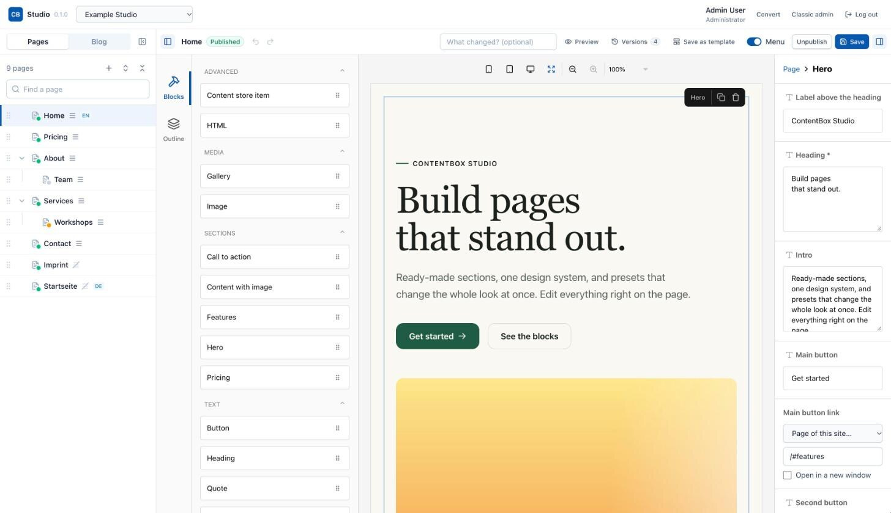
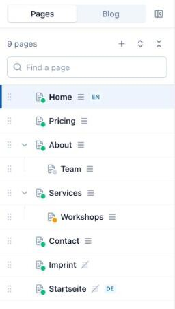
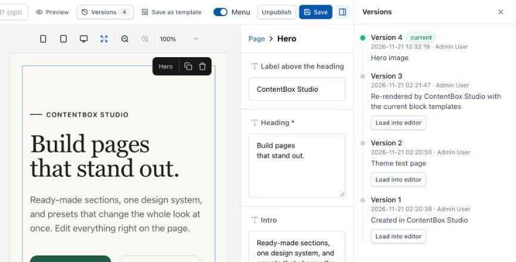
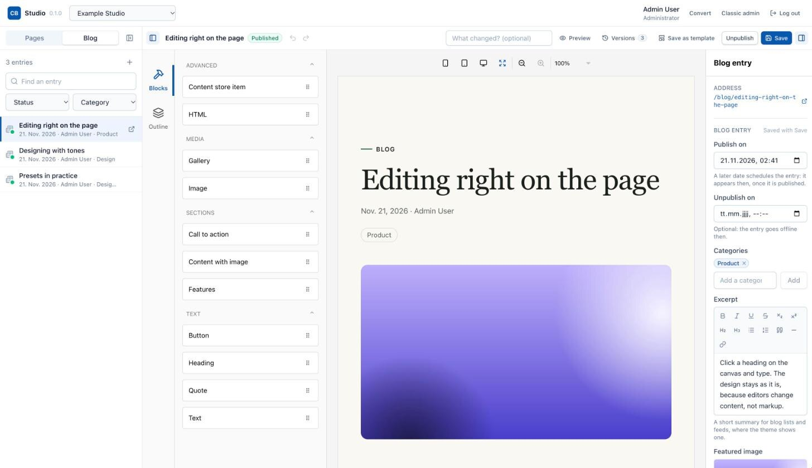

# Editing with ContentBox Studio

A guide for the people who keep a site up to date. For installing and setting up Studio, see
[Installing](installation.md).

## Opening Studio

Log in to ContentBox's admin as usual and choose **Content → Studio**, or go to `/cbstudio`. Studio opens the page
you edited last. If ContentBox has more than one site, the menu at the top switches between them.

The screen has four parts:

- **Pages and Blog** on the left: the site's pages as a tree, or its blog entries.
- **Blocks** next to it: the sections you can add to a page. Drag one onto the page.
- **The page** in the middle, looking as it will on the site.
- **Fields** on the right: the content of the selected block. With no block selected, the page's own settings.

The left columns can be hidden (the buttons next to the page title and at the top of the tree), and the tree can be
made wider by dragging its edge. Studio remembers this per browser.

## Pages

Each page shows:

- a dot for its **status**: green published, grey draft, orange scheduled (goes online at its publish date),
  red expired;
- a **menu icon**, struck through when the page is not in the site's menu;
- its **language**, if the site has pages in several languages.

**New page** (the + at the top, or the + of a page for a subpage) asks for a title and creates a draft, empty or
from a template. **Drag and drop** moves a page: onto another page to make it a subpage, or between two pages to
put it there. Moving a page changes its address; the old address keeps working and leads to the new one.

## Editing a page

- **Add a section:** drag it from **Blocks** onto the page.
- **Change text:** click it on the page and type. Running text gets a small toolbar (bold, italic, headings, lists,
  links); **Esc** or a click elsewhere finishes. Everything else (images, links, colors, layout options) is in the
  fields on the right.
- **Images** come from the media library, which opens in the folder of the current image. You can upload there.
- **Links** to pages of the site are picked from a list; they keep working when a page moves.
- **Move, duplicate or delete** a section with the buttons above it, or drag it. The **Outline** shows all sections
  of the page as a list.
- **Undo and redo** with the arrows next to the title.
- **Sizes:** the buttons above the page show it as on a phone, a tablet, a laptop or at full width.

The page in the middle is rendered by the site itself, so it looks exactly like the published page will.

## Saving and publishing

- **Save** stores your changes as a new version. The field next to it takes a short note about what changed, which
  appears in the versions.
- **Publish / Unpublish** decides whether the page is online. Depending on your role you may save but not publish;
  then someone with the right to publish does that. Changes to a page that is already online are online as soon as
  you save.
- **Menu** decides whether the page appears in the site's menu.
- **Preview** shows the unsaved page in the site's full layout, in a new tab.
- If someone else saved the page while you were editing, Studio does not overwrite their work: reload the page to
  see their changes.

## Versions

**Versions** lists every saved state of the page with date, author and note. **Load into editor** puts an older version
into the editor; saving it makes it the current one again. Nothing is lost by trying.

## Page settings

With no block selected, the right column shows the page's settings, saved with **Save**:

- **Address** of the page, with a link to open it on the site.
- **Search engines:** title and description for search results (with a length hint and a preview of the search
  result) and keywords.
- **Language** and **Translations:** link the versions of a page in different languages, so the site can offer a
  language switch and search engines find the right one.

Other settings (layout, password protection, ...) are in the classic admin; the link is at the end of the column.

**Save as template** keeps the page's sections as a template, so new pages can start from them.

## Blog

The **Blog** tab lists the entries, newest first, with search and filters for status and category. An entry is edited
like a page. Above its sections the page shows the entry's header (title, date, author, categories, image) as the
site shows it; the title is edited right there. The entry's settings on the right: publish date (a later date
schedules it), an optional date to take it offline, categories, excerpt, featured image and whether comments are
allowed.

**New entry** (the + at the top) asks for a title and creates a draft.

## What stays in the classic admin

Comment moderation, categories, menus, users and roles, media management beyond choosing and uploading images, and
the site's settings.
