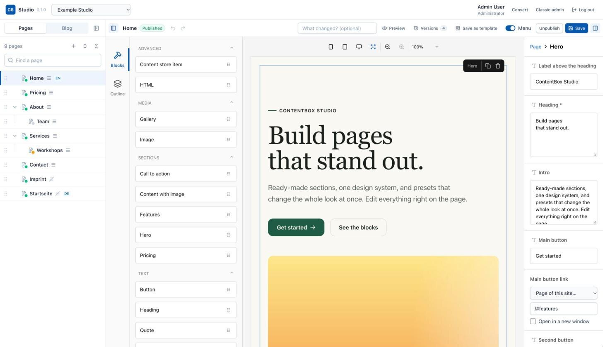
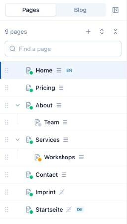
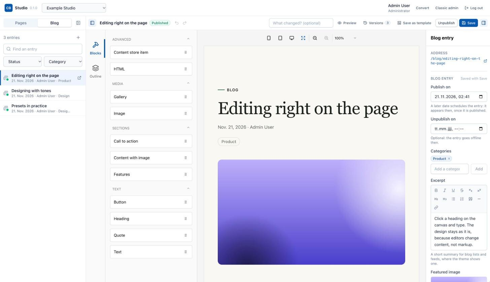
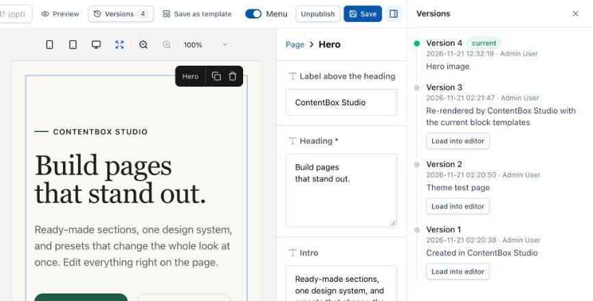
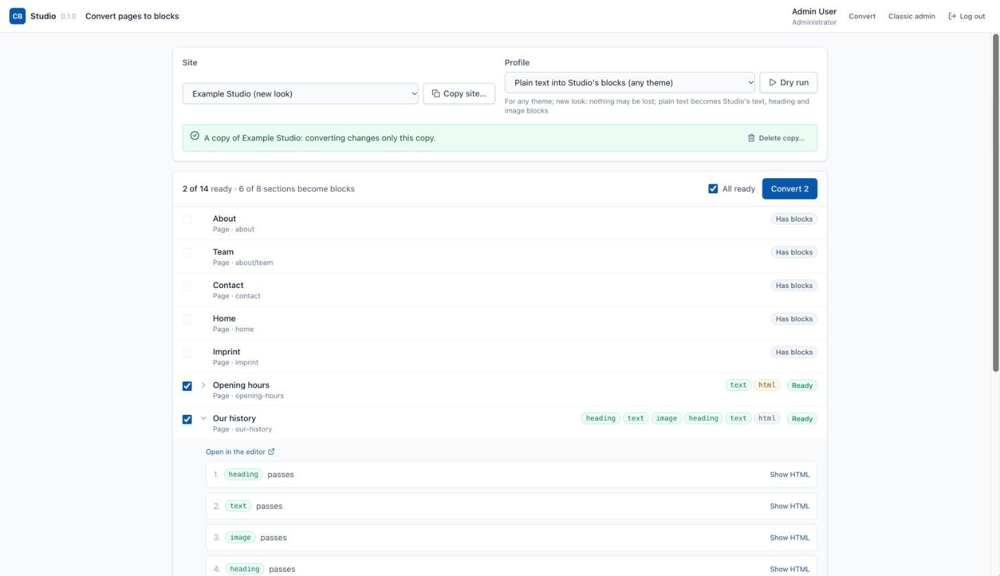

# ContentBox Studio

Block editor and site tree for [ContentBox](https://www.contentboxcms.org) 7, running next to the classic admin at `/cbstudio`.

> Status: 0.1.0, the first release, on [ForgeBox](https://forgebox.io/view/contentbox-studio). In use on a pilot
> site.



**A theme to start with:** [Studio Starter](https://github.com/akitogo/studio-starter) is a ContentBox theme with
ready-made blocks for Studio (hero, content with image, features, pricing, call to action, blog) and switchable design
presets, built with Tailwind CSS. The screenshots here show it.

## Documentation

| | |
|---|---|
| [Editing with Studio](https://github.com/akitogo/contentbox-studio/blob/main/docs/editing.md) | Guide for editors: pages, sections, saving, versions, blog |
| [Installing, upgrading, removing](https://github.com/akitogo/contentbox-studio/blob/main/docs/installation.md) | Requirements, installation, configuration, upgrades, what removing leaves |
| [Blocks in themes](https://github.com/akitogo/contentbox-studio/blob/main/docs/theme-blocks.md) | Adding block types to a theme (`block.json`, `render.cfm`) |
| [Converting existing pages](https://github.com/akitogo/contentbox-studio/blob/main/docs/conversion.md) | Turning hand-written HTML into blocks, on the site or on a copy with a new theme |
| [Block format](https://github.com/akitogo/contentbox-studio/blob/main/docs/block-format.md) | How blocks are stored in the content body |
| [Engine notes](https://github.com/akitogo/contentbox-studio/blob/main/docs/engine-notes.md) | BoxLang and Adobe ColdFusion differences to keep in mind |
| [Changelog](https://github.com/akitogo/contentbox-studio/blob/main/CHANGELOG.md) | What changed in each version |

## Goals

- **Block editor:** pages are built from sections (blocks) that the theme defines, edited as fields with a live preview instead of raw HTML.
- **Site tree:** drag and drop for order and parent page, status at a glance, translation groups.
- **No lock-in:** block data is stored as HTML comments inside the normal content body. Existing pages keep working, versions and the API keep working, and uninstalling leaves plain HTML.
- **Uses ContentBox's own users, roles and permissions** and the ContentBox REST API (JWT).

## Requirements

| | Supported (tested in CI) |
|---|---|
| ContentBox | 7 |
| Engine | BoxLang 1, Adobe ColdFusion 2023, Adobe ColdFusion 2025 (no Lucee, like ContentBox 7) |
| Database | what ContentBox 7 supports (CI: MySQL; development: PostgreSQL 17) |

## Installation

```bash
box install contentbox-studio
```

Then reinit the site and open **Content → Studio** in the classic admin (or `/cbstudio`); Studio uses the classic
admin login. Release zips, installing from git, configuration, upgrades and removal:
[docs/installation.md](https://github.com/akitogo/contentbox-studio/blob/main/docs/installation.md).

## Permissions

Studio adds these permissions when it loads (only if they are missing, so your changes in the admin are kept):

| Permission | Allows | Granted on creation to |
|---|---|---|
| `STUDIO_ACCESS` | Opening Studio and using its API | Administrator, Editor |
| `STUDIO_SITE_TREE` | Moving and reordering pages in the site tree | Administrator, Editor |
| `STUDIO_HTML_BLOCKS` | Adding and editing raw HTML blocks | Administrator |
| `STUDIO_CONVERT` | Converting the HTML of existing content into blocks, copying a site for that (also needs `SITES_ADMIN`) | Administrator |

## How it works

- `/cbstudio` needs a classic admin session with `STUDIO_ACCESS`; without a session you go through the admin login
  (including two-factor authentication) and come back.
- The page passes JWT tokens for the logged-in author to the React app, which uses them for the ContentBox REST API
  (`/cbapi/v1`) and the Studio API (`/cbstudio/api`). Expired access tokens are refreshed automatically.

## Blocks

- A page is a sequence of blocks stored **inside the normal content body**: each block is an HTML comment with its
  data, followed by its rendered HTML ([block format](https://github.com/akitogo/contentbox-studio/blob/main/docs/block-format.md)). Versions, search, the REST API and
  exports keep working; on the public site Studio removes the comments.
- Block types come from Studio (HTML, text, heading, image, gallery, button, quote, content store item), from the
  site's theme and from other modules ([theme blocks](https://github.com/akitogo/contentbox-studio/blob/main/docs/theme-blocks.md)). For a theme with ready-made blocks, see
  [Studio Starter](https://github.com/akitogo/studio-starter).
- The server renders blocks when they are saved. Rich text is stored as a structured document and rendered by the
  server, so it cannot carry arbitrary HTML; raw HTML needs the `HTML` block and the `STUDIO_HTML_BLOCKS` permission.
- In the classic admin, block content shows a notice with a link to Studio and its body is read-only; saving there
  keeps the blocks and changes only the other settings.

## Site tree



- `/cbstudio` opens the editor right away: on the site last worked on, the page or blog entry last edited there
  (remembered per browser), else the site's home page; `?site=<slug>` picks a site. A site without pages offers to
  create the first one. Switching sites asks about unsaved changes first.
- Next to the editor, a column shows the pages of the site as a tree: status as a colored dot (its name on hover), a
  menu icon (struck through when the page is not in the site's menu) and the language. Search keeps matches in
  place. Tabs switch between the pages and the blog (see [Blog](#blog)).
- Drag the column's edge to resize it (double-click resets; wide enough, it shows the addresses) or hide it to a
  narrow strip. Width, visibility and the tab are remembered per browser.
- Drag and drop moves and reorders pages; it needs `STUDIO_SITE_TREE` and `PAGES_ADMIN` or
  `PAGES_EDITOR`. Drop onto a page to make it a subpage, or on its top or bottom edge to place it before or after
  (the bottom edge of an open page makes it the first subpage); a line shows where it lands, collapsed pages open
  when you hover them, and a zone below the tree moves a page to the top level. Moving changes the address of the
  page and its subpages; ContentBox redirects the old ones.
- **New page** (or the + of a page for a subpage) creates a draft with a title, address and parent, empty or from a
  template, and opens it in the editor. Needs `PAGES_ADMIN` or `PAGES_EDITOR`.
- **Translation groups:** pages and blog entries of a site in different languages can be linked (only within the
  site: each site has its own content).
  Each page gets a language code; the public pages get `hreflang` links, and themes can build a language switcher
  from `getInstance( "Translations@contentbox-studio" ).forContent( prc.page ).members`. Stored as the custom fields
  `cbstudio_language` and `cbstudio_translationGroup`.

## Blog



- The **Blog** tab lists the site's entries newest first, drafts, scheduled and expired ones included, with date,
  author, categories, status and language. Search (title or address) and filters for status and category (or no
  category); long blogs load 50 more at a time.
- Clicking an entry opens it in the same block editor as pages. Opening an entry or a page switches the column to the
  matching tab.
- **New entry** creates a draft with a title and address, empty or from a content template for entries (the
  default template is preselected). Needs `ENTRIES_ADMIN` or `ENTRIES_EDITOR`.
- Theme blocks can be limited to some content types (`contentTypes` in `block.json`), e.g. so a page hero is not
  offered in posts.
- An entry's own settings are in the editor's right column and saved with **Save**: publish date (a later one
  schedules it), optional unpublish date, categories (pick one or type a new name; new ones are created on save),
  excerpt (rich text, stored as HTML like ContentBox does), featured image (media library) and comments.
- When a site's blog is turned off (ContentBox site settings, **Enable Blog**), the Blog tab is disabled and the API
  refuses new entries for that site, as the classic admin does. Entries that already exist can still be opened by
  their address.
- Comment moderation, managing categories and the blog's settings stay in the classic admin.

## Editor

- Opening a page, blog entry or content store item from the tree loads it into the block editor (Puck): add, move,
  duplicate and remove blocks; fields on the right. The canvas shows each block rendered by the server with the
  theme's template, so it is what will be saved.
- Text, headings and running text of a block can be edited directly in the canvas (fields of type text, textarea
  and rich text that the template shows unchanged). Rich text gets a formatting toolbar above it (bold, italic,
  subscript, superscript, headings, lists, links, ...) and keeps the theme's look while editing; Esc or a click elsewhere ends editing.
  Everything else is edited in the fields on the right.
- Field types get suitable inputs: rich text (TipTap, stored as a structured document), links with a page picker
  (`page:[slug]`, resolved by ContentBox), images and galleries from ContentBox's media library (with upload),
  content store items, lists of sub-fields, and HTML (only with `STUDIO_HTML_BLOCKS`). The media library opens in the
  folder of the image in use (marked "In use"); for a gallery, in the folder of its last image.
- **Save** stores a new ContentBox version (with an optional change note); history and rollback in the classic admin
  keep working. A save based on an older version than the current one is refused, so nobody overwrites someone
  else's changes unknowingly.
- The canvas loads the stylesheets of the site's theme (the `<link rel="stylesheet">` tags of the site's home page,
  plus the theme's `blocks/editor.css` if it has one), so blocks look like on the site.
- **Undo/redo**, a **Menu** switch for pages (whether the page shows in the site's menu; saved with **Save**, and
  changing it clears ContentBox's cached pages, since the menu is on every page), **Publish/Unpublish** (`PAGES_ADMIN`, `ENTRIES_ADMIN` or `CONTENTSTORE_ADMIN`, as in the classic
  admin: editors can save but not publish; the server enforces it. Unlike the classic admin, an editor's save of
  published content keeps it published, so the change is live at once) and the status
  (draft, scheduled, published, expired) are in the editor's header, as are buttons to hide the blocks and fields
  columns. Undoing every change clears the unsaved marker.
- The canvas shows the page in a viewport (Small 360 px, Medium 768 px, Large 1280 px, Full width), scaled down to
  fit; it never zooms beyond that. Full width shows it at 100 % at the canvas's own width. The viewport and the hidden
  columns are remembered per browser.
- For blog entries, the canvas shows the entry's header above the blocks as the theme renders it on the site (title,
  date, author, categories, featured image; see [Blocks in themes](https://github.com/akitogo/contentbox-studio/blob/main/docs/theme-blocks.md)). It follows the entry
  settings as they are edited, and the title is edited right there, saved with **Save** (the address stays).
- With no block selected, the right column shows the content's settings: address, a blog entry's settings (see
  [Blog](#blog)), search engine fields (title, meta description and keywords, with length hints and a collapsible preview
  of the search result with the full address), language (needs `STUDIO_SITE_TREE`), translations, and a link to the other settings (layout, ...)
  in the classic admin. Everything but the translation links is saved with **Save**, like the blocks.
- After saving, publishing, creating, moving or linking translations, Studio announces ContentBox's
  `cbadmin_post<Type>Save` events like the classic admin: ContentBox clears its content, page, sitemap and RSS caches,
  updates menu items that point to a moved page, and sends its notifications for new pages and entries (if they are
  on in ContentBox's settings, also for content created in Studio); other modules can listen too.
- **Save** only adds a version when the blocks changed; saving only settings keeps the version (ContentBox does not
  version them).
- Opening other content with unsaved changes asks first.
- **Preview** renders the unsaved blocks with the site's theme and layout through ContentBox's own preview.
- **Versions** lists the history; loading a version puts its blocks into the editor, saving makes it current.

  

- **Save as template** stores the saved blocks as a ContentBox content template; new content of the same type can
  start from it (block presets). Marked as the default, it becomes ContentBox's global template of the type and is
  preselected for new pages or entries. Templates are also listed in the classic admin.
- Content written in the classic editor opens as one HTML block; blocks changed outside Studio are pointed out.

## Converting existing pages

Existing pages are hand-written HTML and open as one HTML block. The conversion tool turns them into blocks with a
**conversion profile** (CSS selectors per block field, or code for complex sections), page by page and only where
nothing is lost: each block is rendered and compared with the section it replaces. For a new look it works on a
**copy of the site** with another theme, so the original stays as it is. Plain text (paragraphs, headings, lists,
images) can become Studio's own text, heading and image blocks without writing a profile (built-in profile
"plain-text"). **Convert** in Studio's header
(administrators) opens the tool: copy a site, pick a profile, see per page and section what becomes a block and what
differs, convert the pages that are ready. See [docs/conversion.md](https://github.com/akitogo/contentbox-studio/blob/main/docs/conversion.md).



## Settings

In `config/ColdBox.cfc` of the site, `moduleSettings[ "contentbox-studio" ]`:

| Setting | Default | |
|---|---|---|
| `coreBlockStyles` | `true` | Links `includes/blocks.css` (base styles of the core blocks) on public pages with blocks and in the editor canvas. Its selectors have no specificity, so theme rules always win; set it to `false` if the theme styles the core blocks completely. |
| `hreflangLinks` | `true` | Adds `hreflang` links for translated pages and entries to public pages. Set it to `false` if the theme writes its own, e.g. from canonical URLs, with `getInstance( "Translations@contentbox-studio" ).forContent( page ).members`. |
| `devServer` | `CBSTUDIO_DEV_SERVER` | See Development. |

## Development

The module is developed inside a ContentBox 7 site, linked as `modules_app/contentbox-studio`.

**Code layout:**

| Path | What |
|---|---|
| `ModuleConfig.cfc`, `handlers/`, `views/` | The `/cbstudio` page (serves the app) and the classic admin integration |
| `modules/contentbox-studio-api/` | The Studio API at `/cbstudio/api`: routes and thin handlers only |
| `models/` | All logic: `blocks/` (format, registry, renderer), `tree/` (site tree, status, translations), `blog/`, `editor/` (save, versions, media, theme styles), `convert/` (conversion tool, site copy) |
| `blocks/`, `includes/`, `interceptors/` | Core block types, their CSS, block output on the public site and the classic admin guard |
| `ui/` → `dist/` | The React app (Vite, Puck, TipTap) and its build, which the module serves |
| `tests/`, `docs/` | TestBox specs and fixtures; block format, theme blocks, conversion, engine notes |

The API is a submodule because cbsecurity has one firewall per module, and the two parts authenticate differently:
the page needs the classic admin session and redirects to the admin login, the API checks JWT tokens (the same ones
as `/cbapi/v1`) and answers 401/403 as JSON. ContentBox splits its admin and its REST API the same way
(`contentbox-admin`, `contentbox-api`).

```bash
cd ui
npm ci
npm run build        # builds the app into dist/, which the module serves
npm test             # Vitest
npm run typecheck
```

- **Hot reload:** set `CBSTUDIO_DEV_SERVER=http://localhost:5173` in the site's `.env`, restart the server, run
  `npm run dev` in `ui/` and open `/cbstudio`.
- **CFML tests (TestBox):** open `/modules_app/contentbox-studio/tests/runner.cfm` on the site. They reuse ContentBox's
  test application (`tests/Application.cfc` of a ContentBox source checkout) and the ORM dialect from `ORM_DIALECT`.
- **Engine pitfalls:** see [docs/engine-notes.md](https://github.com/akitogo/contentbox-studio/blob/main/docs/engine-notes.md).
- **CI** (`.github/workflows/ci.yml`): UI checks, then the TestBox suite in a ContentBox `development` checkout with its
  MySQL fixture on BoxLang 1 and Adobe ColdFusion 2023/2025.
- **Releases** (`.github/workflows/release.yml`): set the version in `box.json` and a section for it in
  `CHANGELOG.md`, commit, then push a tag `v<version>` (e.g. `v0.1.0`). The workflow runs CI, builds the editor,
  packs `contentbox-studio-<version>.zip` (with `dist/`, without `ui/`, `tests/` and `.github/`), creates the GitHub
  release with that zip and the changelog section, and publishes the version to ForgeBox with the zip as its
  location. It needs the repository secret `FORGEBOX_API_TOKEN`.

## License

Apache License 2.0, see [LICENSE](https://github.com/akitogo/contentbox-studio/blob/main/LICENSE).
